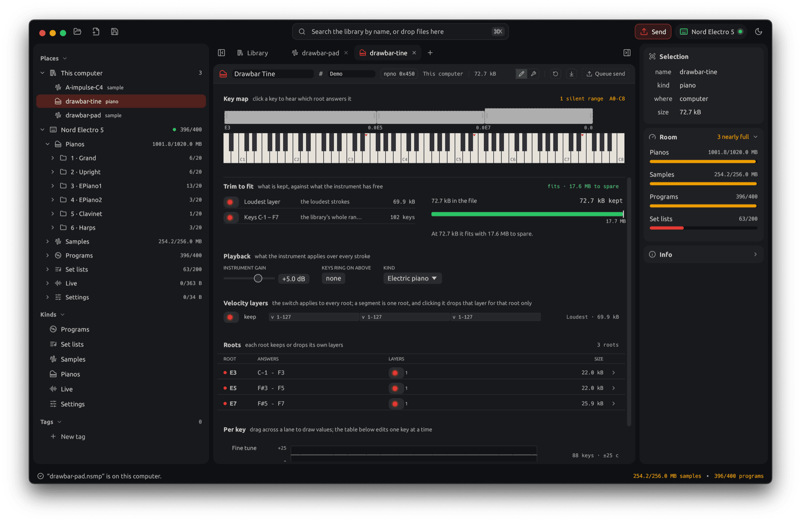

# Copy and send sounds over USB

Start by copying a sound **from** the keyboard. You can edit that copy and
choose later whether to send it back. Before making changes on the instrument,
make a full backup with Nord Sound Manager. [Check support for your keyboard](../getting-started/support.md#usb).

## Connecting

1. Close Nord Sound Manager so it releases the USB connection. Connect your
   powered-on instrument to the computer by USB.
2. Choose **Connect instrument…** at the top of drawbar. In a browser, select
   your instrument in the device picker. The desktop app opens the first Nord
   it finds.
3. Look for your instrument's name on the left. Expand **Programs** and a bank
   to see its slots. An address like **7:4** means bank 7, slot 4, just as on
   the panel. The **Keyboard** tab also shows empty slots.

If your instrument doesn't appear, check [browser USB support](../getting-started/support.md#usb)
or [USB permissions on Linux](../getting-started/install.md#connecting-on-linux).
To refresh the listing after changes on the keyboard, choose **Instrument ▸
Read everything**.

## Copy a sound to this computer

Right-click an occupied slot and choose **Copy to this computer**, or drag it
onto **This computer**. Find the copy under **This computer** and double-click
it to edit. You can select several slots and copy them together.

**Open** on the instrument slot itself opens a view of the keyboard's copy.
**Save in that view writes back to the slot directly.** If you want to try
changes locally and review them later, work on the copy under **This computer**.

## Sending

1. Drag a sound from **This computer** onto the slot you want in the matching
   instrument folder. Choose an empty slot to keep the original sound in place.
   For a sound already linked to a slot, **Queue send** in its editor targets
   that slot. Saving edits to a linked library copy can also queue it.
2. Click **Send** in the top bar. Its count tells you how many sounds are
   waiting. Select a row to compare what the slot holds now with what you're
   about to send. Click its destination to choose another slot, or **×** to
   take it out of the queue.
3. Choose **Send all** when the destinations are right. Store any unsaved
   changes on the keyboard's panel first. Writing settings or the slot you're
   currently playing reloads the panel.
4. Once the write finishes, load the program on the keyboard to hear it.
   **Load on instrument** in a linked document plays the version currently in
   the slot.

If several library sounds differ from their original slots, **Queue** beside
**Send** adds them together. If a transfer is refused, check the activity log.
The remaining sounds stay queued. Disconnecting also keeps the queue. Review
the destinations again after reconnecting.

## Slots

Right-click a slot for its available actions. **Load on instrument** selects
it on the panel. You can rename, duplicate or delete a program there. Dragging
a slot onto another slot in the same instrument folder **swaps** them. These
actions work on the keyboard itself.

A file's name becomes the slot name without the extension. Samples and pianos
each need a unique name in their instrument folder. If the name is already in
use, drawbar targets that slot for replacement. Rename your local file first
to keep both. To duplicate or rename a sample or piano, copy it to this
computer and send the renamed copy.

To copy programs or songs with the sounds they depend on, [export a bundle](this-computer.md#bundles).

## Safety

Before replacing an occupied program, song, piano or sample, drawbar keeps a
copy of the old sound. If the transfer fails, it tries to put that sound back.
If it can't, the activity log tells you where to find the copy. [Recover a sound after an interrupted write](recovery.md#a-change-was-interrupted).

If a browser tab was open during a drawbar update, reload it before replacing
a sound. Until it can keep a recovery copy, drawbar allows transfers only to
empty slots. A damaged piano or sample fails verification and cannot be sent.
If a piano is too large for the free memory, [trim it to fit](pianos.md#trim-to-fit).

A folder the app doesn't recognize is read-only. For the hardware on which
transfers and recovery have been tested, see [What is supported](../getting-started/support.md#usb).
