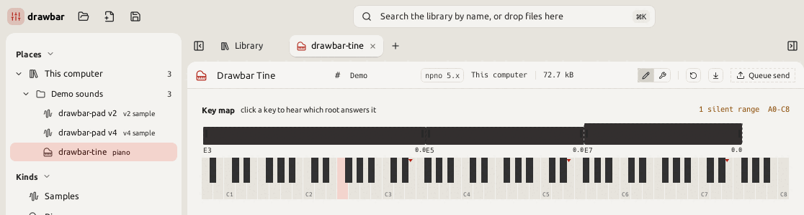

# Play your first sound

Start with the demo electric piano. All you need is your computer, its speakers
or headphones, and a connection to download the sounds.

1. [Open drawbar](https://drawbar.app/). On the welcome screen, choose **Start
   with a demo**. If you're already in the app, choose **Help ▸ Welcome**.
   In the browser, the menus are under **☰** at the right end of the top bar.
2. On the left under **This computer**, expand **Demo sounds**. Double-click
   **drawbar-tine**. The piano opens in a tab in the center of the window.
3. Find **Key map** and click a key under one of the bands. You'll hear the
   electric piano. Try another key under the same band. Both play the same
   recording at different pitches. Keys beyond the last band are silent.
4. Under **Roots**, open a row. A *root* is the note at which a sound was
   recorded. Here you can listen to that recording on its own or save it as a WAV.

The demo folder also holds a pad in two sample formats. Double-click
**drawbar-pad v2** to try its key map. Click the piano's tab to get back to it.
You can choose **Start with a demo** again to bring back a demo file you removed.

## Find your way around

- **On the left**, **This computer** holds your files. A connected instrument
  appears under its own name, with folders for the sounds on the keyboard.
- **In the center**, the **Library** tab helps you find sounds across both
  places. Double-click a sound to open its editor. The **Keyboard** tab shows
  the connected instrument bank by bank.
- **On the right**, the inspector shows what you selected and actions you can
  take. **Room** shows how much space the connected instrument has left.
- **At the bottom**, the status line tells you what just happened. Click it for
  the activity log. The magnifier changes the size of text and controls.

Use the buttons at either end of the tab row to hide or show the side panels.
Drag a panel's inside edge to give it more room. The sun and moon control
switches between the system, light and dark themes.

## Menus

On a Mac, the desktop app's menus are in the system menu bar. On Windows,
they're at the left of the top bar. On Linux and in a browser, open **☰**.
The menus show the shortcuts for your platform, and
[Keyboard shortcuts](shortcuts.md) lists them.

## MIDI controllers

To play a sample or piano from a controller, connect the controller to the
computer, open the sound's tab, and choose **Instrument ▸ Listen to MIDI
controllers**. Play a few notes. You'll hear the sound through the computer.
The frontmost sample or piano tab is the one you play.

In a browser, allow MIDI access when asked and turn listening on again when you
return. If the controller is busy, close the other music app, then turn
listening off and on. [Check browser MIDI support](../getting-started/support.md#midi-controllers).

## Bring in your own sounds

Drop a file on the window to add a copy to **This computer**. To start with a
sound that's on your keyboard, follow [Copy and send sounds over USB](instrument.md).
