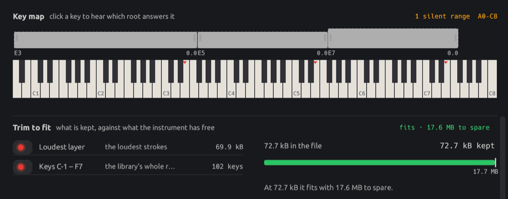

# Trim or build a piano

A piano library (`.npno`) can hold several recordings of the same note: a soft
strike, a loud strike, the sound of the pedal, or the release when you lift your
finger. If the library is too large for your keyboard, you can choose which
recordings are worth the space for the part you'll play.

## Trim to fit

1. Connect the instrument so drawbar can read its free piano memory. Find the
   piano under **This computer**. To keep the full version,
   right-click the piano and choose **Duplicate**. Open the copy and find
   **Trim to fit** below the keys.
2. Compare the size kept with the space available. For a split where you play
   piano only with your right hand, try narrowing **Keys** to that range.
   To keep the full keyboard, try removing **Pedal resonance**, **Release
   samples** or a velocity layer instead. The meter suggests a cut that would
   free enough space.
3. Click keys across the range you'll play, especially at its ends. A hatched
   range is silent. You can switch a layer back on or widen the range while
   you try different cuts.
4. When the meter says the piano fits, choose **Save** on your working copy.
   Use **Export…** if you also want the smaller file elsewhere. Saving,
   exporting or queuing a piano can write the cuts into its library file.
   Choose **Revert** before any of those actions to discard your trial cuts.

For finer cuts, open **Velocity layers**. Each lane represents a layer and
each segment a recorded note, or *root*. Click a segment to drop that layer
for just that root. The velocity ranges shown assume the program's **KBD
Touch** is at 0. The on-screen piano and MIDI preview play the loudest layer
you've kept for each key. Test the full playing dynamics on your instrument.
[Send the piano to the keyboard](instrument.md#sending).

## Change how the piano plays

- **Key map.** Drag the boundary between two roots to give keys to the
  neighboring recording. Drag the outside edges to change the covered range.
- **Playback.** **Instrument gain** changes the overall level. **Keys ring on
  above** sets the highest key that is damped when you let go. **Kind** changes
  where the keyboard files an existing piano.
- **Roots.** Open a row to hear a recording, save a WAV, adjust its level or
  drop that root. Format 6.x allows level adjustments in tenths of a decibel
  and can boost a stroke. Format 5.x trims in whole decibels.
- **Per key.** Adjust fine tuning for a single key or draw a tuning change
  across several keys.

## A new library

If you've recorded several notes into **one long WAV**, start with
[Make a piano from a recording](recording.md). If you already have **one WAV
per recording**, build the library directly:

1. Choose **New ▸ Piano library (.npno)…**. Select your WAVs. Use 16-bit PCM,
   mono or stereo, at any sample rate.
2. Enter a name and **Category**. For each WAV, choose the root, the bank
   (attack, pedal resonance or release), and the layer. A filename such as
   `060-b0-l00.wav` fills in middle C, attack and the loudest layer for you.
3. For a sustained organ or pad, choose **Hybrid**, then open **Advanced** and
   select **Don't decay long notes**. The note keeps its recorded decay and
   its loop holds steady. For a piano, leave the box clear so the sound fades
   as you hold the key.
4. Choose **Create**, then try keys on the map and inspect the roots. To use
   the finished library on the keyboard, [choose a destination and review the send](instrument.md#sending).

A loop marked in an attack WAV repeats while you hold the key. Audio beyond
the loop end is left out. A release recording plays when you lift the key,
at the level the note has reached by then. Release recordings cannot loop.

A new library uses format 6.x by default. If your keyboard needs 5.x, choose
it under **Advanced ▸ Format**. To borrow playback settings from an existing
piano, choose it under **Advanced ▸ Template**. The template also determines
the format. [See which builds and edits have been played on hardware](../getting-started/support.md#piano-libraries).
