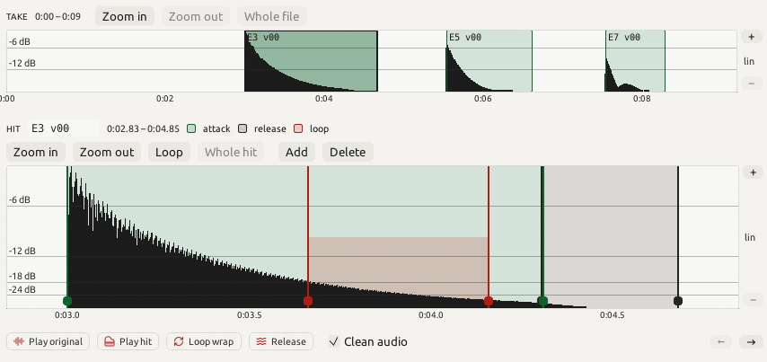

# Make a piano from a recording

You can turn a single WAV of yourself playing individual notes into a piano
library. drawbar finds the notes, lets you listen and adjust where each one
starts and ends, then builds a file you can play on the keyboard. If each
recording is already a separate WAV, [build from individual files](pianos.md#a-new-library).

## Try the practice take

<a href="../assets/tine-take.wav" download>Download the practice WAV</a>.
It contains three notes from drawbar's demo electric piano, with a little quiet
before the first strike. Drop the file on drawbar, double-click **tine-take**
under **This computer**, and choose **Detect**.

Look for **E3**, **E5** and **E7** over the waveform. Select **E3** and try
**Loop wrap** to hear where the held note repeats. Select **E5** next. That
note dies away quickly enough to get a fade. You can
[build a piano](#build-and-try-the-piano) from these marks or adjust them first.

## Record and find the notes

1. Start the recording with three to five seconds of quiet so drawbar can
   hear the background noise. Leave some headroom when you play. A peak around
   −6 dB on your recorder is a good starting point.
2. Play one note at a time and let it die away. To capture changes in touch,
   strike the same note softly and firmly, leaving space between strikes.
   Each strike is a *hit*. The whole recording is the *take*.
3. Drop the WAV on drawbar and double-click it under **This computer**.
   The top waveform shows the whole take. Choose **Play** to hear it.
4. Choose **Detect**. This replaces any existing note marks in the take.
   A box appears around each marked hit. A label such as **C4 v22** gives
   its note and layer. The message above the waveform tells you how many
   hits were marked or skipped.

If quiet notes are missing, check **Skip hits … or less over noise**. Lower
the threshold before detecting again to include quieter hits. Listen for hiss:
bringing a quiet recording up in level can bring the noise up too. For just
one missed note, add it by hand.

## Check a hit by ear

Click a box in the top waveform. The lower waveform shows that hit in detail.
The **attack** starts when you strike the note, a **loop** repeats part of it
while you hold the key, and the **release** sounds when you lift your finger.

| To hear… | Use |
|---|---|
| The selected passage as recorded | **Play original** |
| The note as it would sound held and released | Hold **Play hit**, then let go. A quick click plays through it once. |
| Whether a loop clicks where it repeats | **Loop wrap**. Click again to stop. |
| Just the sound of lifting the key | **Release** |

Use the left and right arrows below the hit to check its neighbors. If the
release is hard to see, use **+** beside the waveform to make quiet sounds
taller. **−** takes the display back toward its original scale. These buttons
change only the view.

## Correct a note or loop

- **A note starts late or includes the next sound.** Drag its start or end
  marker in the lower waveform. Use **Zoom in** for a closer view and drag the
  waveform sideways to move along it. **Whole hit** brings its ends back
  into view.
- **A loop clicks.** Choose **Loop** to zoom to the join. Move its markers
  while checking with **Loop wrap**. A marker snaps to a nearby point where
  the waveform crosses zero. Hold Alt to place it exactly.
- **A note was missed or mislabeled.** Click the missing strike
  in the upper waveform and choose **Add ▸ Hit**. To rename it, type a note
  and layer such as `D4 v30` above the lower waveform, then leave the box.
  Escape cancels. A red name is invalid or already taken.
- **A note needs a loop or release.** Select the hit and choose **Add ▸ Loop**
  or **Add ▸ Release**, then adjust the markers. Use **Delete** to remove a
  hit, loop or release mark. The recording itself stays intact.

## Build and try the piano

1. Choose the take's **Category**. This gives the new piano its playback
   defaults. Leave **Clean audio** on to reduce hum and hiss, or turn it off to
   keep the recorded sound. A long take can take a few seconds to analyze.
2. Choose **Build piano library…** at the top. It becomes available once you
   have marked hits. It uses the current marks, including unsaved edits.
   Check the name and category, then choose **Create**.
3. The piano opens in a new tab. Play a few notes on its key map. Check the transition
   between neighboring notes. To change a cut or a loop, go back to the WAV, adjust
   the mark and build again.
4. Return to the WAV tab and choose **Save** to keep the marks and cleaning choice
   for another session. [Trim or send the piano](pianos.md#trim-to-fit) when
   you're ready.

## Adjust a WAV's level

You can also use the WAV editor on its own. Set **Gain**, check the clipping
message, then choose **Apply gain**. The amount is relative to the last save:
applying 10 dB and then 12 dB gives a total increase of 12 dB. Set it to 0 dB
to return to the saved level. **Save** writes the audio at its new level and
keeps the WAV's sample format.

The editor reads uncompressed 8-, 16-, 24- and 32-bit PCM and 32- or 64-bit
floating-point WAVs. Use a sample rate of at least 8 kHz. For WAVs over 120 MB, use the
[desktop app](../getting-started/install.md#on-the-desktop). A marked take can
be built from these formats. The
[one-WAV-per-stroke piano builder](pianos.md#a-new-library) and the
[sample instrument builder](samples.md#start-with-wav-files) have their own
input requirements.
