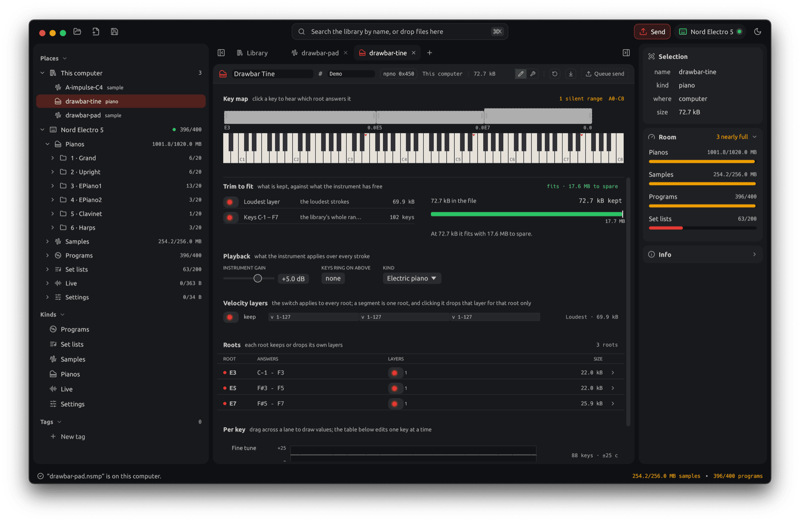

# drawbar

drawbar manages the sounds on your Nord keyboard. Copy them to your computer,
keep them organized and backed up, edit programs and set lists, and build new
samples and pianos from your own recordings.

drawbar runs in your browser or as a desktop app.

<a class="button primary" href="https://drawbar.app/">Open drawbar</a>
<a class="button" href="getting-started/install.md#windows">Windows</a>
<a class="button" href="getting-started/install.md#macos">macOS</a>
<a class="button" href="getting-started/install.md#linux">Linux</a>

> **Alpha software.** drawbar is developed against one instrument.
> [What is supported](getting-started/support.md) lists what has been tested on
> hardware. Keep copies of your files, and make a full instrument backup in Nord
> Sound Manager before changing sounds on the keyboard.

### Your keyboard

Connect over USB to see every bank and slot beside your own files. Copy a sound
to your computer, edit it, and queue it to send back when you're ready.

[Your keyboard](drawbar/instrument.md) · [Copy and send](drawbar/sending.md)

### Your library

Import programs, samples, pianos and set lists, then file them in folders and
tag them by band, venue or song. Keep the library in a folder that syncs
between computers, back it up, or bundle a program with the sounds it plays.

[Organize](drawbar/organize.md) · [Folders and sync](drawbar/folders.md) · [Back up](drawbar/backup.md) · [Bundles](drawbar/bundles.md)

### Programs and set lists

Change a program from its panel controls. Arrange the programs each song in a
set list calls up, and keep a note with stage cues beside them.

[Edit a program](drawbar/editing.md) · [Set lists and notes](drawbar/setlists.md)

### Samples and pianos

Map your WAV recordings across the keys as a sample instrument, or build a piano
from separate notes or one long take. Trim a piano to fit the memory your
keyboard has left, and listen through the computer before you send it.

[Build your own sounds](drawbar/building.md) · [Samples](drawbar/samples.md) · [Pianos](drawbar/pianos.md) · [From a recording](drawbar/recording.md)

New to the app? [The window](drawbar/overview.md) shows where everything is and
lets you try a demo piano without a keyboard. If something goes wrong, see
[Help](drawbar/help.md).

## Also in this guide

- **The `nord` command** inspects files, makes the same edit across several
  patches and copies sounds to and from a keyboard, from a terminal. Start with
  its [overview](nord-cli/overview.md).
- **Reference** is for developers: [building from source](reference/building.md),
  the [file formats](reference/file-formats.md), the USB protocol and how to
  contribute. The source is on [GitHub](https://github.com/jmoo/drawbar).

## Disclaimer

Not affiliated with, authorized, or endorsed by Clavia DMI AB. "Nord", "Clavia",
and "Electro" are trademarks of Clavia DMI AB, used here only to identify the
hardware these formats come from. Proprietary sound libraries and firmware are
not distributed here.
