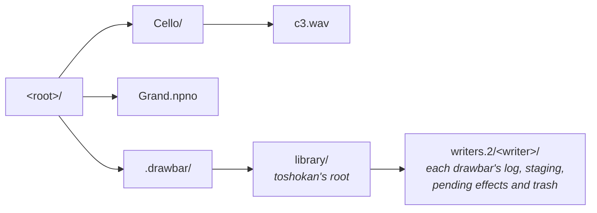
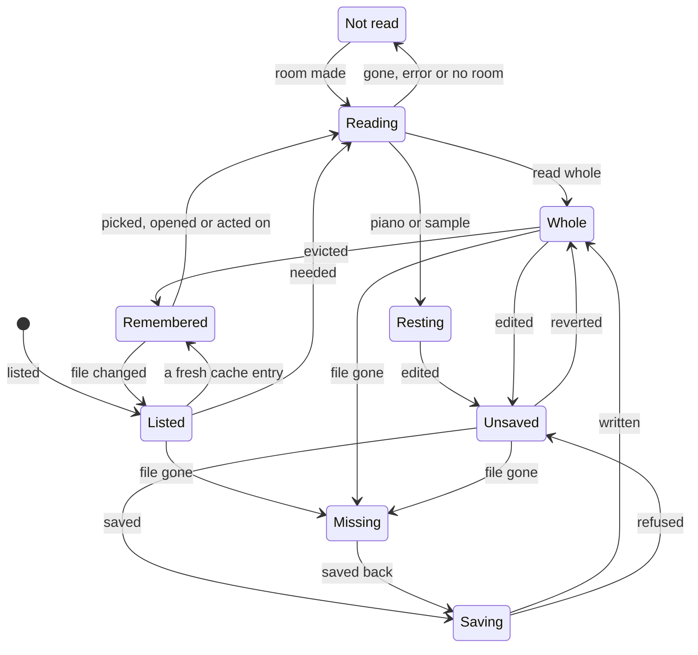
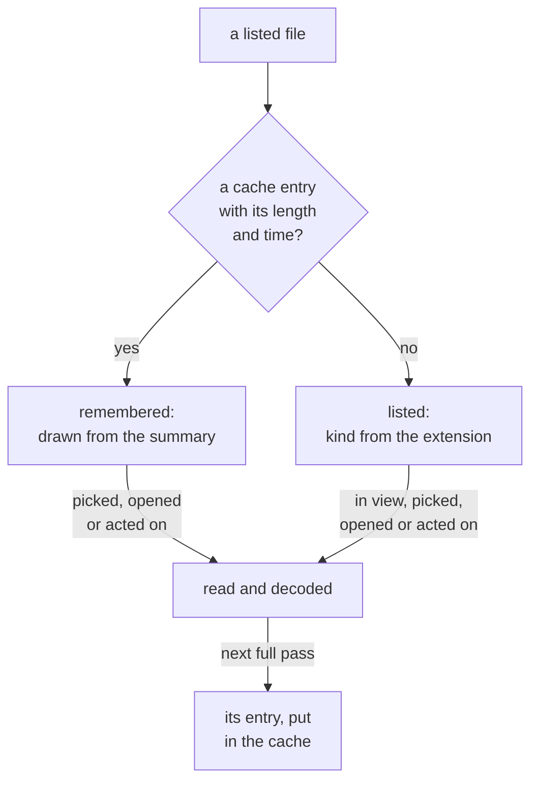

# Library data model

drawbar keeps This computer as a folder of real files. This page describes how
the app models that folder, how it reads and writes it, and how it stays
consistent with changes made outside drawbar. What a user sees of it is on
[Your files](../drawbar/this-computer.md).

The code is in `crates/drawbar/src`: `store/` holds the library on disk,
`workspace.rs` the assets in memory, `folders.rs` the folder tree, `ondisk.rs`
the files left on disk and read by range, and `summary.rs` with
`store/cache.rs` what drawbar remembers of a read between sessions. What a file
cannot say, and every change to the files, goes through
[toshokan](https://github.com/jmoo/drawbar/tree/master/crates/toshokan), whose
[`SPEC.md`](https://github.com/jmoo/drawbar/blob/master/crates/toshokan/SPEC.md) describes its format and guarantees.

## The library on disk

A library is a folder tree. A folder in the sidebar is a directory, an asset is
a file, and a move is a rename. Any folder can be opened as a library.

- **Desktop:** the default library is `library` in the folder eframe keeps the
  app's data in (`eframe::storage_dir`): `~/Library/Application Support/drawbar`
  on macOS, `$XDG_DATA_HOME/drawbar` or `~/.local/share/drawbar` on Linux. On
  Windows that folder is in the roaming app data, which a domain profile copies at
  every sign-in, so the library is `%LOCALAPPDATA%\drawbar\library` instead,
  falling back to the roaming folder when `LOCALAPPDATA` is unset
  (`store::native::default_root`).
- **Browser:** the root of the origin private file system (OPFS), or in browsers
  with `showDirectoryPicker` a folder the user picked (`store::web::Root`). See
  [In the browser](#in-the-browser).

What a file cannot say lives in a hidden `.drawbar/` folder at the root, which
holds toshokan's root, `.drawbar/library/`:



`.drawbar/library/` is made at the first change, never on open, so a folder
opened and looked at stays as it was. The default library's folder is also made
at its first change. A scan leaves out all of `.drawbar/`, and every other name
that starts with a dot (`store::keys::layout`). An older build's
`.drawbar/library.ron`, `working/` and `tmp/rescued-*` stay where they are,
unread, and the first open of the folder by this install says where they are
(`store::older`).

### What the library keeps

Every running drawbar writes as a writer of its own: it appends to a log of its
own under `writers.2/`, and reads the others' logs. Nothing is written in place, so
several drawbars may change one library at once, on one computer or on several
that sync the folder, and each sees what the others did when it reads their logs
again. toshokan merges every log to the same state, whatever order a sync client
delivers them in.

The facts are fields of entities (`store/keys.rs`):

| Key | Kind | Meaning |
|---|---|---|
| `tags` | set of names | The tags an asset wears. |
| `tag names` | set of names | The library's list of tags, every one made, worn or not. Two drawbars that make a list at once each keep one, and the tags are all their names together. |
| `origin` | register | Where an asset came from, where its file cannot say: `{"from":"new"}` for New, `{"from":"slot","class":…,"bank":…,"slot":…}` for a copy off a slot, `{"from":"rescued","bank":…,"slot":…}` for a rescue kept. Banks and slots are numbered from zero, as the wire numbers them. |

An entity is made only for a file with something its file cannot say: tags, an
origin, or the list of tags itself. Every other file is known from the listing
alone, by its path, so a library of untouched files keeps nothing about them, and
the hidden folder grows with tags, not with the number of files. toshokan binds
each entity to its file by path, and where the file moved, by the file's
identity (`store::keys::Contents`): BLAKE3 over a flag, the file's length and its
bytes. A Nord file in its CBIN container is read only at its first 64 KiB and its
last two bytes, which hold its checksum, so a piano library's identity costs a
small read; any other file is read whole.

A change the user makes is an intent: one undo step, logged with what it changed,
checked against the files before anything is written. Each file it writes is
staged in the writer's `tmp/`, and bytes it would write over or delete move to the
writer's `trash/`, where an undo finds them.

### This install's own state

What only this install needs is kept in drawbar's own data, never in the library
(`store::native::local_root`): `libraries/<hash of the library's path>/`, beside
`app.ron`. It holds toshokan's local root, with the identities its scans read and the drafts of unsaved edits; `slots/`, for the unsaved edits
of slot views, each replaced whole under the lock `replacing.lock` so that two
drawbars or tabs never interleave; and `rescued/`, for a slot's former occupant
that a write to the instrument left. Losing it loses the drafts and nothing
else. Two drawbars on one machine share it, each writing as a writer of its own;
one that opens takes up what an idle one left, its drafts and its unfinished
effects included.

A draft is the asset's unsaved bytes, or the edit held of a piano or sample
instrument resting in its file, under a line that says which
(`store/drafts.rs`), kept with the identity of the file it was made over. An
edit is kept as RON text under a version of its own (`rewrite::Edit::working`):

```text
(
    version: 1,
    edit: Sample([
        ("name", "Vibes"),
    ]),
)
```

A sample's edit is the `path = value` sets made since it was saved, and a piano's
is its plan (`document::piano::Plan`), the format's banks and kinds written by
their codes.

## The in-memory model

### The workspace and its assets

`Workspace` (`workspace.rs`) is the model the rest of the app edits. It holds
every asset as a `LocalEntity`. The fields that matter here:

| Field | Meaning |
|---|---|
| `id` | Names the asset to the store, the selection and the send queue. See [Ids](#ids). |
| `name` | Its name. While `path` is set, it is the path's last component. |
| `path` | Where its file is. `None` for a view, and for a kept asset not yet placed. |
| `origin` | Where it came from: a file, a slot, the New menu, or a rescue. |
| `bytes` | Its current bytes, a shared `Bytes`. Empty while it is unread or rests in its file. |
| `entity` | What the bytes decode to, boxed, or `None` before the decode or where it failed. |
| `saved` | Its `Baseline`: what it was last saved as. |
| `kept` | Whether it is on this computer, as opposed to a view of a slot. |
| `pending` | Whether an editor holds an edit not yet applied to `bytes`. |
| `stamp` | Distinct for every set of bytes this id has held. Bytes back to the baseline's take its stamp, so the baseline does not move and nothing is written. |
| `remembered` | While it is unread, the `Summary` a read of its file found before. See [The derived cache](#the-derived-cache). |

`Bytes` wraps an `Arc<[u8]>`. The baseline shares the allocation while the bytes
are the same, so a clean asset is held once; an edit puts new bytes in place and
never writes through the shared allocation.

A `Baseline` is what the asset was last saved as:

| Field | Meaning |
|---|---|
| `bytes` | The saved bytes, or empty where `file` or `unread` holds them. |
| `crc32` | The checksum a slot holding these bytes would report: the CRC-32 of the body without its container. `device::link` and `library::agrees` decide on it. |
| `stamp` | The stamp of these bytes. The asset is unsaved when `stamp` differs from its own, or `pending` is set. |
| `file` | The file holding these bytes, left on disk and read by range (`ondisk::OnDisk`). |
| `unread` | The file's length, while nothing has read it. |

`LocalEntity::is_unsaved` compares stamps, never bodies: every listed row asks
it every frame.

A send that lands moves the baseline to what it sent (`Workspace::landed`). An
asset sent from the file it rests in keeps that file as its baseline, and
`Workspace::landed_file` sets the link and the write from the checksum its check
took; nothing reads the file again. An asset resting in another file by the
time the send lands, as one whose edit was saved during the send does, keeps
resting there, and its write records the checksum of what the slot took, so the
slot shows as behind. An asset that holds its bytes in memory by then takes the
sent file as its baseline again under a stamp of its own, so an edit made
meanwhile shows as unsaved.

### Ids

The workspace hands out ids from `next_id`, for the session only. The store maps
each id to how the library knows its file (`store::Key`, `store/ids.rs`): by the
entity bound to it, or by its path. An asset keeps its id when its file becomes
an entity, when it moves, inside drawbar or outside it, and when an undo moves it
back. A lost row, an entity whose file is gone, keeps its id while the library
keeps the entity.

### Views and kept assets

A view is a working copy of a slot on the instrument. It is not listed, has no
file, and goes when its tab closes. `Workspace::keep` promotes one into the
list, and closing the tab of a view that holds an edit, or that waits in the
send queue, promotes it instead of dropping it. A view has no file a draft could
be made over, so its unsaved edit is kept by its slot instead
(`store/slots.rs`): in `slots/<instrument>-<class>-<bank>-<slot>`, named by the
first 8 bytes of the BLAKE3 hash of the instrument's serial number, or its
product name where it reports none, a line with the BLAKE3 hash of the bytes the
view was opened over, then the view's bytes. A view asks for the edit kept of
its slot at the first pass after it appears, and keeps none of its own before the
answer. One over the same bytes is put back unsaved; one over other bytes is put
back, and the user is asked which to keep, as for a file changed on disk. Where
the view was edited before the answer, the user is asked whether to keep the
edit, take the earlier one, or keep both, the earlier as a new asset. Sending the
view, reverting it, keeping it on this computer or closing it lets the edit
go.

## An asset's lifecycle



- **Listed.** The asset holds its file's name, length and time, and nothing
  else. Its baseline's `unread` is set, its verify state is `Reading`, and its
  kind comes from its extension.
- **Remembered.** Still unread, but the cache holds a summary of an earlier read
  of the file, taken at the length and time it has now. It draws its kind, tag,
  slot checksum, the library it plays and its verdict from that summary, and its
  verify state is `Remembered`. A row in view does not read it.
- **Reading.** Something needs it, or it wears tags or came off a slot and is
  read in the background. A `FileCmd::Read` for its file is in flight.
- **Whole.** Its bytes are in memory. They are decoded off the frame, up to eight
  jobs of 64 files or 16 MiB at once on the desktop, and one job of 16 files or
  2 MiB a frame in the browser. An act about to use the decode runs it at once
  (`Workspace::read_now`). Decoding re-encodes and compares, as for any file
  that arrives.
- **Resting.** A piano library or sample instrument stays in its file, indexed.
  Its checksum is checked off the frame, one file at a time, once something needs
  the verdict: opening it, sending it, or a background read for its slot
  (`Workspace::check_soon`). A row drawn does not, so until then it is `Unchecked`,
  and `Checking` while the check runs. A send queues an unchecked file and asks for
  its check, and nothing is written until the check has passed. A file that fails
  its check is not sent. On the desktop each
  resting file holds a file handle open, so the desktop raises its open-file
  limit at start (`ondisk::raise_open_files`). In the browser it holds the `File`
  snapshot the page took of it.
- **Unsaved.** Its stamp differs from its baseline's. At the next full pass its
  bytes are kept as a draft, unless the draft holds them already. An edit of a
  resting asset stays an edit held over its file, and the asset stays resting
  until the save writes the file again; its draft keeps the edit, not the
  bytes.
- **Saving.** Saving moves the baseline to the current bytes and asks the store
  to write it (`workspace::FileAsk::Save`). A baseline that rests in its file
  needs no write. A save refused because the file changed, and one that failed,
  leave the asset unsaved again.
- **Missing.** Its file went missing while it held something precious: tags, an
  unsaved edit, the slot it came off, or a place in the send queue. Nothing
  writes its file again until it is saved, and that save creates the file anew.
  A file deleted outside drawbar that holds nothing precious leaves the list.
- **Not read.** The library could not read it. It stays unread and is not asked
  for again, except for a read refused for room, which is retried once room can
  be made.

A clean asset that is evicted goes back to unread under a new stamp, and keeps
its baseline's `crc32` and a summary of what it held, so it is Remembered: it
still draws as it did and matches its slot. A change on disk to an unread file
drops that checksum and the summary, since they no longer stand for the file,
and it is Listed again.

## Listing and reading

### The metadata walk

Opening a library shows at once the view this install kept of it: its assets and
their tags, and no other file (`Cmd::Open`). A scan of every file follows at
once (`Cmd::Rescan`): it lists every file by its name, length and time, through
toshokan's scan, and reads a file only for its identity, where nothing earlier
gives it and it decides which file is an asset's: a file at an asset's path with
its length, and a file of the length of an asset that may have moved, as one
whose path holds nothing does. A copy of an asset's file is a file like any
other. The header counts the files found as the scan goes; in the browser the
library's worker says the count (`store::counted`). The scan also says which
folders it listed, so they are not listed again to show them.

1. Each folder is listed with every file's length and time in one request.
2. Anything under a name that starts with a dot is left out, and a dot folder is
   not entered.
3. A scan looks at no more than 1,000,000 entries. A folder past that, or one
   that cannot be listed, is reported as not all listed, the log names it, and
   the rest of the library opens.

The folders themselves are listed by the backend beside the scan, since toshokan
keeps no folders (`store::keeper`).

A file's kind is decided by its extension alone: `store::opens` matches it,
ignoring case, against the formats `nord-format` names by extension
(`formats::by_extension`) and drawbar's notes (`browser::tagged`). Any other file is listed by name only, as one of the
folder's `others`, and shown with **Show all files**.

### Lazy reads

A listed asset is read once something needs it. The workspace keeps each one
wanted with how much it is needed, and the store keeps one `FileCmd::Read` in flight:
when it answers, the next goes out with the most needed of what is wanted then,
at most 32 files or 8 MiB. Nothing is asked until the cache has said what it
remembers. In order of need, these ask:

- an act that works from an asset's contents, which waits until each asset in
  `Act::reads` has been read (`browser/act.rs`), and the app, every frame, for
  what is open in a tab (`Workspace::hurry`);
- the app, once each time the selection changes, for the first 64 assets
  selected (`Workspace::select`). Each stays wanted until it is read, for as long
  as it stays selected. An act on the rest reads what it needs;
- `Workspace::in_view`, for the rows the library table draws. A row draws what is
  remembered of it, so only a row with nothing remembered is read, and a row not
  drawn this frame or the last is no longer read for it.

An asset needed this frame or the last, or selected, is not evicted.

### Background reads

Once the listing is complete and the cache has answered, and again at each full
pass, the store reads the unread files it tracks, whole: those with tags or a
slot they came off (`Store::fetch_tracked`). Reading them decodes them, or checks
those that rest in their files, and takes their slot checksum, so they match their
slots on the instrument before anything shows them. A remembered file is skipped, since its summary already carries that
checksum. They go 32 files or 16 MiB at a time, and a read the user waits on runs
after the batch in flight. None starts while a read something needs is wanted or
in flight.

### The memory budget

The assets may hold at most 1 GiB of a library's files whole
(`exec::MOST_BYTES`). The count is every asset's bytes, plus its baseline's
where they are not the same allocation, plus the listed length of every read in
flight. A file resting in its file takes none of it.

Each `FileCmd::Read` carries the room left. The backend reads its files in order,
and answers each one that would not fit in what is left with `Failure::Room`.
The store then makes room by evicting clean assets, the least recently needed
first, and those with tags or a slot they came off only after the rest
(`Store::make_room`). It
evicts nothing unless that makes the room. A background read evicts only
untracked assets.

These are never evicted:

- a view, an unsaved asset, or one with a pending edit;
- one unread already, or resting in its file;
- one needed this frame or the last, or selected;
- one in the send queue;
- one with a save in flight, or a missing file;
- one whose path is under a rename not yet answered.

A read that cannot fit even then marks the asset not read, and it is retried,
smallest first, once room can be made.

### Reading by range

`OnDisk::open` indexes a CBIN file whose tag is `npno` or `nsmp` with
`nord_format::formats::npno::Index` or `nsmp::Index`. Those read only the
container header, the prefix and the stroke or zone directory, and give the
byte range of each stroke's audio. A piano document reads one stroke by its
range (`OnDisk::read`). A file whose index does not read is read whole, so its
decode can say why.

The index does not verify the container checksum. The resting check does, in
one streaming pass that also takes the whole file's CRC-32 for its fingerprint
(`OnDisk::verify`). Until it has, a resting file is not known to hold any
bytes (`OnDisk::holds`), and nothing takes its CRC on the frame. A save, a copy
over a file and a rewrite are each checked by toshokan, once the new contents are
staged and before anything is written over, against the file as drawbar last
read or wrote it (see [Identities and expectations](#identities-and-expectations)).
A resting file changed on disk under an unsaved edit is not
read whole to keep the edit apart: the asset rests in the new file, and the
workspace makes the edit again over it (`rewrite::Edit::over`). An edit the new
file already holds is let go. One that no longer applies is kept as it was,
still unsaved, and refuses to be saved, sent or copied until it is edited again
or reverted. On the desktop the handle follows the file through a rename, and
reads whatever the file holds now if it is rewritten in place; a rescan notices
that and indexes it again.

In the browser a read answers only later. The indexes read through a reader
over the slices fetched so far (`ondisk::Slices`), which reports the file's
real length and fails naming the range it lacks; the backend fetches that range,
at least 64 KiB of it within the file's first 64 KiB and 4 KiB past them
(`ondisk::FETCH`, `ondisk::STEP`), and reads the index again. A piano's index
arrives in one fetch after the 12 bytes that say what the file is, and a sample's
in one small fetch per stroke, so indexing a sample reads little of its audio. A read on the frame of a stroke not fetched yet answers
`WouldBlock` and fetches it, and the repaint when it lands plays it. A pass over
the whole file, the checksum or a whole read, streams 4 MiB slices in a task of
its own. A `File` snapshot fails to read once its file is written, so a move this
tab makes takes the snapshot again where the file went, and a file written over
is indexed again.

A file from outside, dropped or picked with File ▸ Open…, is copied into the
library by `Intent::Import` and never held (`Act::Take`). Its asset waits unread
until the copy lands (`Workspace::arrive`), then rests where it is a piano or
sample instrument and is read on demand otherwise. A name already taken asks, as
a rename does: Overwrite copies over the file there (`Act::TakeOver`), with the
same check a save makes, and Keep both copies under a free name. A copy whose name
something took first is placed again, and one that fails is read into memory
instead. The copy streams into toshokan's staging a chunk at a time, and never
passes through memory whole. The browser catches a drop on its way to the canvas
(`dropped.rs`), since eframe reads a dropped file whole, and lands it in the
folder whose tree row it fell on. The desktop windowing reports no drop point, so
there a drop lands at the top level unless the pointer moved over the window while
the files hovered.

A sample's document draws from the index's outline, and an open zone reads its
own stroke's range. An edit of it is held over the file as the sets made since
it was saved, and the outline they make (`document::sample::Edits`). A piano
plan over a resting library is checked against the index's stroke directory,
which carries each stroke's range. Either way the workspace holds the edit, as
the sets or the plan (`rewrite::Edit`), and the rewrite that saves it into the
file the asset rests in (`Workspace::hold_edit`, `rewrite.rs`). An editor takes
up the workspace's edit wherever the asset rests in a file its own edit was not
made over. A save sends
`Intent::Rewrite`: toshokan stages the file the edit makes of the one the asset
rests in, a chunk at a time (`store::keeper`), moves the old file to the trash and
puts the new one in its place, and the asset rests in what it wrote. A sample's
copy splices the edited sections in and restates the checksum
(`cbin::Patch::copy`); a piano's is laid out by `npno::Library::write_from`,
which reads one kept stroke at a time by its range. A sample's copy checks its
checksum as it streams, so a file changed since its index was read is refused. A
piano's copy reads the file's prefix and stroke directory again first
(`npno::Index::still_matches`), and refuses one that is not the directory its
index read; its audio is not compared. Nothing is put over the file then. An
export or send of an asset holding such an edit waits for it to be saved first.
An edit held this way is kept across a quit as a draft of the edit itself, and
the next open makes it again over the file.

Duplicate, Keep both, and an Overwrite that puts a resting file over another, are
copies the library makes too (`Workspace::arrive`, `store::CopyOf`):
`Intent::Import` copies the library's own file byte for byte, a chunk at a time,
or writes the edit held of it through as it copies. The copy's
asset is unread until it lands, then rests in it. A file a copy is still to be
made of is not deleted until the copy answers, and the asset an Overwrite moved
over another file goes only once its copy has landed: one that fails leaves it. Exporting a resting file copies it across
without reading it into memory.

A send never reads a resting file whole either. The command carries the file
(`device::Payload::File`), and the worker reads it one transfer chunk at a time
through `nord_usb::FileSource`: by position through the handle on the desktop,
and by `File.slice` through the snapshot in the browser. A file that fails to read
partway through a send fails it as a refused write does, and the slot's occupant
is put back.

Nor is an occupant held whole. Before a write replaces one, the worker reads it
back through `op::read_into` into a file, a transfer chunk at a time, so it can put
it back through `write_from` if the write fails (`worker::put`). The file is
written under a `.partial` name, closed, checked against the length and checksum
it was read with (`op::verify_read`), and only then renamed to its own name, with
its folder synced, all before the delete. A process that dies with the slot empty
leaves the whole occupant on disk, and one that dies during the read leaves only
a `.partial` file and the slot as it was. A power cut is covered only where the
folder sync is: on macOS and Linux, not on Windows, and not in the browser, which
offers no sync at all. The file (`device::scratch`) is in `rescued/` of this
install's own state for the library on the desktop while the library may be
written, or a `rescued` folder of drawbar's own data (`eframe::storage_dir`)
otherwise, never the system's temporary folder or the library. In the browser it
is in `rescued/` of the library's local root in OPFS, or of the browser's own
library's where none is open, written through a toshokan storage worker of the
device's own. That worker starts with the session's first rescue, from the
bundle the page loaded: where drawbar.app was deployed again since, it cannot
load, and a send that would replace an occupant is refused, as it is wherever
there is nowhere to keep one, until the page is reloaded.
The restore runs in a session of its own once the failed write's session has
closed (`worker::put_back`): the instrument drops a write left unfinished when its
session closes, but keeps it as an object in another slot when a second write
follows it in the same session. The file is deleted once the slot holds what it
should. Where the restore fails as well, or a delete may have landed, it stays,
`DeviceEvent::Kept` names it in the log, and the next open offers it. It is the
only copy drawbar keeps. The file is named as its rescue,
`nord-rescued-<bank>-<slot>.<tag>`, numbered where that name is taken. An open
removes the `.partial` ones, which never are a slot's only copy.

Once a library that may be written opens, each file named that way in both
`rescued` folders is offered in a question (`Browser::ask_rescue`). Each is read
through first and checked against its stored checksum (`envelope::verify`). One
that does not read is said to be no copy of the slot, and offered only to be
discarded. **Keep in library** copies it into the library's top level under its
own name, or a free one, with the slot its name gives as its origin, and deletes
it once the copy lands. **Show the file** opens its folder and asks again.
**Discard** asks once more, then deletes it. **Later** leaves it to be offered at
the next open.

The queue compares a resting file with a slot's occupant by the checksum its
check took, so its diff says only whether the bodies differ. The instrument
reports no checksum for a piano or sample slot. One whose body length, which it
does report, differs from the asset's is different without a read. One of the
same length is read through `op::read_into` into `std::io::sink()`
(`DeviceEvent::Summed`), and its CRC-32 decides.

## The store protocol

`Store` (`store/mirror.rs`) is the app's side of a library. It turns what the
user asked of the workspace into intents, and folds what it hears back into the
workspace. A backend runs what it is told. They talk in `Cmd`s and `Event`s
(`store/mod.rs`), and the app never waits for an answer: the desktop backend runs
on a thread of its own, which owns the toshokan library (`store/keeper.rs`), and
reads files and makes folders through `exec::Fs` (`store/native.rs`).

| Command | Answered by |
|---|---|
| `Open` | `Opened`: whether the library may be written, the view after a scan of every file, and the drafts an earlier session kept. |
| `Rescan` | `Scanned`: what other drawbars wrote, and every file scanned again. |
| `Refresh` | `Scanned`: what other drawbars wrote, scanning only the files their entries moved. |
| `Intent` | A change to a file answers `Saved`, `Rewritten`, `Imported`, `Moved` or, for a delete that failed, `Failed`; then every intent answers `Committed`, with the view after it and whether it was made. |
| `Undo`, `Redo` | `Committed`, with the files no entity is bound to that it moved. |
| `Settle` | `Committed`: another drawbar's unfinished effect, finished, rolled back or left. |
| `Draft`, `Discard` | Only `Unkept`, on failure. |
| `KeepSlot`, `DiscardSlot` | Only `Unkept`, on failure. |
| `ReadSlot` | `SlotKept`: the edit kept of a slot's view, with the hash it was made over. |
| `File(Read)` | `Read`: each file, held whole or resting, or why not. |

The intents are `Tag`, `Untag`, `MakeTag`, `RenameTag`, `RemoveTag` and `Forget`
for the facts; `Save`, `Rewrite`, `Import`, `Move`, `MoveFolder` and `Delete` for
the files; and `MakeDir` and `RemoveDir` for folders, which an undo takes back
too. `Batch` carries the changes of one gesture as one intent: the keeper builds
them into one toshokan intent, answers each part as it would be answered alone,
by whether its file or folder landed, and where a file a part copies could not be
read before anything was written, answers that part and commits the rest without
it. A commit
may also answer `Trimmed`, the changes whose undo the trash no longer holds.
Each view an answer carries is projected onto the workspace from what it changed
since the view before (`toshokan::View::changed_since`); the view an answer
carries with every folder listed again, after a rescan, an undo, a redo or a
settlement, is projected whole. A change to a file names it by its path; the backend finds the
entity bound there, if any, in the view it commits against. A new file whose
asset came from a slot, a rescue or New is made as an entity's file, with its
origin. A delete moves the file to the trash and ends its entity.

### Asking for changes

The workspace records each change to a file the user makes, where the user makes
it (`workspace::FileAsk`): a save, which makes the file where the asset has none;
a move; and a delete. Following a change the library made, or one made outside
drawbar, asks for nothing (`Workspace::follow`). Folder changes are queued the
same way by the browser's folders (`folders::Op`), and copies by the workspace's
arriving assets. `Store::sync` takes them in order and gathers what one pass
takes, which is one gesture's, into one intent.

A change waits for the answer to one before it where it depends on it: a write
over a file whose last write has not answered, and anything that touches a
rename not yet answered, since were the rename refused, the change would act on
whatever else has that name. A change that waits holds back every one after it.
A change that waits for an answer splits its gesture: those after it go as an
intent of their own. An overwrite deletes the file it came from in its own
intent, and a tag on files the same pass saves new goes on them as they are made.
While a rescan is in flight, `Store::sync` sends nothing, so the rescan's listing
describes the files as the commands before it left them.

A change to the tags names an asset by the file the library knows it by. A tag
for an asset whose file is still on its way waits for it; one for an asset whose
file could not be written goes without it, and says so (`Store::writes`). A new
tag put on assets is one intent with its making, and while its name's editor is
open, it and every change to the tags after it wait, so the name chosen is the
one made (`Tags::name_new`). The tag list is the one part of the workspace that
runs ahead of the library: a new tag, a rename or a removal shows at once, and
the names the library's view holds come back if the library refuses it.

### Undo

Every intent is one step of this session's undo, and only this session's. What
an undo takes back, and when it is refused because another drawbar changed the
same thing since, is in [Undo and redo](https://github.com/jmoo/drawbar/blob/master/crates/toshokan/SPEC.md#undo-and-redo). The Edit menu names
each step by its intent and what it names (`Intent::describe`), from the steps
the library made (`Committed::made`); a change that failed is no step. The
workspace follows what an undo moved or changed without a word about changes
outside drawbar (`Viewed::undone`).

## Writes and crash safety

Every write to a library file is toshokan's, staged, recorded and moved into
place as [File effects and pending records](https://github.com/jmoo/drawbar/blob/master/crates/toshokan/SPEC.md#file-effects-and-pending-records)
describes, so a crash leaves each path holding its old bytes or its new ones and
the next open finishes or rolls back the change. drawbar never reads a file whole
to write it: bytes held whole are written from memory, and every copy and every
edit through a resting file is streamed a chunk at a time. drawbar's own reads,
like toshokan's writes, refuse a path through a folder that is a link.

The trash keeps what a delete or a save displaced for undo. A commit that leaves
this writer's trash past 1 GiB empties it of the oldest items, and the Edit menu
stops at the first change whose undo needed one. Closing the library empties it
of what this session's changes put there, since no later undo reaches them.
Opening a library that may be written empties it of what was displaced more than
30 days ago, and then of the oldest past 1 GiB (`toshokan::Policy::default`).
Which writer's trash an instance empties is in [Trash](https://github.com/jmoo/drawbar/blob/master/crates/toshokan/SPEC.md#trash).

### Drafts

An unsaved edit is kept as a toshokan draft in this install's own state, never in
the library (see [This install's own state](#this-installs-own-state)). A
`Pass::Full`, at most every 2 seconds and on eframe's 5-second autosave, keeps
each edit that changed since it was last kept, and lets go of the drafts of
assets saved, gone or known by another key since; at exit, `Store::close` waits
for what is in flight, then runs a `Pass::Last`, repeating until nothing more is
sent. A crash loses the edits made since the last full pass. A draft is made only
over a file drawbar has read, by its identity, so an asset never written has
none; a view's edit is kept by its slot (see
[Views and kept assets](#views-and-kept-assets)). A library that cannot be written keeps no drafts, and says so when
it opens.

At open, each draft is put back over its asset once the asset's file is read,
which the open asks for. A draft whose file no longer holds what it was made over
is put back over the file as it is now, and the user is asked which to keep (see
[Conflicts](#conflicts)). One whose file is gone is kept for when it is back.

### Opening and read-only

Opening reads the logs, then scans every file.
Opening writes nothing in the folder: a writer's directory is made at its first
change. A library opens read-only where toshokan finds it cannot write: the
folder cannot be written, or this writer's own log holds entries a newer build
wrote. Several drawbars may write one library at once, so another drawbar's open
makes none read-only. Changes in a read-only library are held in memory only.

What toshokan shows derives from the files in the folder alone, and it keeps
nothing between opens. Facts no file holds now, as after a restore of the folder from a
backup, are gone at the next read. While a sync client is still delivering the
folder's files, facts can disappear and come back; a change made meanwhile is at
worst a visible conflict, never a silent overwrite.

An effect interrupted by a crash, of this instance's writer or an idle one of
this install, is finished at open. One another install left is asked about:
finish it, roll it back, or leave it (`Browser::ask_unfinished`, `Cmd::Settle`).
Every read of the library reports the ones that stand, and drawbar asks only
about one that a read finds unmoved five seconds after it first found it as it
stands (`UNFINISHED_STANDS`, `Orphan::progress`): a drawbar in a browser tab on
the same folder is no writer whose lock this one can see, and may be making the
change still, as a copy of a large file can for minutes. One another window of
this install left once that window stopped is finished at the next read, as at
open.
A record that does not read is left, and the log says how many.

### In the browser

The library is kept by a dedicated worker of its own (`store::worker`), started
from drawbar's own bundle: the page hands it the URL of the bundle's wasm-bindgen
glue and the module it already compiled, so the worker needs no script beside the
page, whatever the bundle's hashed names are. The worker runs the same keeper as
the desktop's thread (`store::keeper`), over toshokan's `web::Executor`, which
writes OPFS through sync access handles and a picked folder through writable
streams. Nothing needs shared memory, so the page needs no cross-origin
isolation.

The page sends every command but a read to the worker, one at a time and in
order, and waits for its answers. A command and its answers cross as JSON
(`store::wire`); the bytes a save or a draft carries, and the `File` a copy from
outside reads, are handed over beside the text, the bytes in a transferred
buffer. An answer carries only what it changed of what the app shows
(`store::shown::Change`), and all of it only as the library opens and after an
answer the page could not read. A fault in the worker fails what waits on it, and
the app closes the library, which opens again with a fresh worker. A command that
shows no life for a minute, no answer and no file found (`Backend::waiting`),
asks whether to close and reopen the library; closing one that stopped or does
not answer writes nothing more and names the edits not yet kept as drafts. The
desktop's thread is watched the same way. The page
reads files itself, from the folder's handles, and indexes a piano or sample it
leaves resting in its file through a `File` snapshot, taken again where a move
the worker made carried the file. An edit of a resting file is sent as the pieces
that lay out the new file (`rewrite::Pieces`): the bytes the edit holds, and the
ranges of the old file it keeps, which the worker reads from the library as
toshokan stages the new one.

The local root is `.drawbar/local/private/` of OPFS for the browser's own
library, and `.drawbar/local/picked-<id>/` for a picked folder, by its id in the
recent list. Tabs of one install write as writers of its pool (see
[Browsers](https://github.com/jmoo/drawbar/blob/master/crates/toshokan/SPEC.md#browsers)). Each tab tells the library's other tabs of its commits over
a `BroadcastChannel` named by the local root (`toshokan::web::Hints`), and a tab
that hears of one refreshes. A picked folder, which another program may write, is
also rescanned when its tab is shown or focused again, every minute while it is
in view, and where Chromium's `FileSystemObserver` reports a change. Names in a
picked folder compare as a look at it finds, ignoring case where a name's other
case reaches the same entry, and in one normalization form on macOS; in OPFS
they compare byte for byte.

## Identities and expectations

A fingerprint (`store::Fingerprint`) is what drawbar knows of a file it read or
wrote: its length and modification time, its CRC-32 once something read the
whole file, and its identity once drawbar read or wrote it. A change to the file
expects that file (`Fingerprint::expect`): by its identity where drawbar has it,
and by the length and time a listing found otherwise, for a file drawbar has not
read. toshokan reads the identity afresh at the check, so a file rewritten
outside drawbar under its old length and time is not written over.

### When drawbar looks again

The store rescans when the window comes back into focus, and before a send to
the instrument, which waits for the answer and goes ahead only if nothing in the
send queue changed on disk (`Store::hold_send`). It also rescans after a failure
that may mean the disk changed: a save refused because the file changed, a
refused rename, a failed command, or a read of a file that is gone. A rescan
reads what other drawbars wrote, and the log says whose change to the tags it
was.

A rescan rereads a file drawbar holds only where its stat moved. An unread file's
new stat replaces its fingerprint, and nothing reads it.

### Following changes outside

toshokan binds each entity to its file: at the path its facts give, or, where the
file moved, at the file the scan found with the identity it last had. An entity's
file renamed or moved outside drawbar is followed, and the asset keeps its id, its
tags and its origin. A file no entity is bound to is known by its path alone, so
its rename outside reads as one file gone and another arrived, and it has nothing
to lose.

A file drawbar knew that is gone, and that no new file matches, has vanished. One
with nothing precious leaves the list as deleted outside drawbar. One with tags,
an unsaved edit, a slot it came off or a place in the queue stays, marked
missing. After a restart an entity whose file is gone and that wears tags shows
as a lost row, with its tags, until the user forgets it.

### Kept apart

**Kept apart** is the user's name for toshokan's items, and one card is one item
(`View::items`): what toshokan cannot place in a writer's single history and
shows apart from the merged state. Most often it is a *run*, which the user sees
as a branch: the entries of a writer after the point where its history forked, as
when two installs went on from one copy of drawbar's own data. The others are
entries whose predecessor has not synced, and lines of a segment shorter than a
snapshot certified it. Every view the store sends carries them as `Viewed::kept`, each a
`KeptApart` naming its run, and drawbar lists them in **Kept apart**
(`Folders::kept`), logging each run once. A card lists a row per change the user
would tell apart (`kept_rows`): a tag's entry in the list of tags only where no
asset in the run wears it, and a file change only where the asset's file is
elsewhere; its title counts those rows. `Intent::Take` makes the
named changes of a run, or all of them, in one entry the user can undo; taking a
tag also takes the run's entry for it in the list of tags, and taking a file change
binds the entity to the file the run names, which toshokan refuses
(`Invalid::Unbindable`) unless the last scan found it there for no other entity.
`Intent::Dismiss` hides a branch from every reader and is not undoable; a run
stays listed, with no changes, until it is dismissed. Entries waiting on a
predecessor offer neither, and are merged once it arrives. A read that finds this
writer's own history forked retires it (`Refreshed::retired`, or
`Start::Rekeyed` at open), which `Viewed::retired` carries to the log.

### Conflicts

A file changed on disk under an unsaved edit is rebased: the file's contents
become the baseline, and the edit stays. The user is then asked:

- **Keep mine** leaves it so. The next save writes the edit over the file, whose
  new identity it now expects.
- **Take theirs** reverts to the new baseline.
- **Keep both** writes the edit as a new file beside it under a free name, and
  reverts the original.

Neither revert writes the changed file again.

At open, a draft over a file that changed since raises the same question. An
edit's draft is made again over the file as it is now, and asks only where the
file does not already hold the edit. One that no longer applies is kept as it
was.

## Names

A library can be copied between macOS, Windows and Linux, so every name drawbar
creates follows the strictest rule of the three (`store/names.rs`). A name is
refused when it is empty, `.` or `..`; holds `/ \ : * ? " < > |` or a control
character; starts or ends with a space; starts with a dot, which hides it; ends
with a dot, which Windows drops; is a Windows device name such as `CON` or
`LPT1`, in any case and with any extension; or is longer than 255 bytes of
UTF-8.

On Windows, a file or folder already in the library under a name Windows
cannot open (one with a forbidden or control character, a trailing space or
dot, or a device name) is refused by name before drawbar opens it
(`names::windows_refusal`).

A name the user typed is refused with its reason. A name the app chose is made
to fit instead (`names::portable`): forbidden characters become `-`, control
characters go, spaces and dots are trimmed from the ends, a device name gains a
leading `_`, and an overlong name is cut, keeping its extension.

Two names in one folder collide when they are equal lowercased by Unicode's
mapping and in normalization form C (`names::key`), since APFS and NTFS compare
names without case, and APFS takes a precomposed `é` and `e` with a combining
accent for one name. toshokan compares a library's paths the same way on macOS
and Windows, and byte for byte elsewhere (`store::keys::Volume`). A free name is
numbered before the extension: `c3 2.wav`, then `c3 3.wav` (`names::free`).

The name box in a document's header edits the name a sample or piano stores
inside itself, and leaves the file's name alone. An instrument from the original
Sample Library stores none, so its box renames the file.

Where a name is taken, `Folders::clash` says by what: an asset, a folder, a lost
row, or a file drawbar does not hold. The user chooses **Overwrite**, offered
only where the occupant is an asset with nothing unsaved, which writes the new
contents into its file and keeps its tags. The asset renamed or moved onto the
name goes once that save lands, as a removal by hand does (`Store::take_left`),
and stays where it does not, or where it was edited meanwhile
(`Workspace::save_over`); **Keep both**, under the free name;
or **Cancel**. A folder already holding two entries under one key refuses the
name outright. Such duplicates, found on a disk that tells case apart, are
flagged and logged and never renamed, since either name may be the one other
files refer to.

## Opening and switching libraries

A window has one library open at a time, and drawbar opens the last one again at
start. The recent list always offers the default library. A picked folder is
called by its folder's name where the default library says This computer.

Switching runs the last pass of the library being left, so its unsaved edits
stay in its drafts and come back unsaved at its next open. Views stay in
the window (see [Views and kept assets](#views-and-kept-assets)), and the left
library's assets come off the send queue. A read-only library cannot keep
unsaved edits, so leaving one asks before discarding them. A library that cannot
be written holds what is opened into it in memory.

In the browser:

- Where the browser has no `showDirectoryPicker`, **Open library folder…** is
  absent and the library is always the private file system; where the API is
  turned off, the item is grayed out. Which browsers have it is on
  [What is supported](../getting-started/support.md).
- A picked folder's write permission lasts until drawbar.app closes, unless the
  user allowed the site on every visit. A handle restored from IndexedDB comes
  back without it, so at start drawbar opens the private library, and **File ▸
  Reconnect** *name* asks again on a click. If the user refuses, the open library
  stays open. A command that fails while the browser no longer grants the
  permission closes the folder the same way (`Backend::denied`).
- The page cannot reveal a picked folder in the file manager, and the origin's
  storage quota does not apply to one. **Help ▸ About drawbar** shows how much of
  the quota drawbar uses: the private library, or a picked folder's drafts and
  slot edits, which are kept in the private file system.
- The first write to a library calls `navigator.storage.persist()`, which the
  browser grants, refuses or asks the user about. Where the browser gives the page
  no storage, drawbar says so and the library lasts until the tab closes.
- A tab and the desktop app on one picked folder are two installs, as two
  computers that sync the folder are (see [Writers](https://github.com/jmoo/drawbar/blob/master/crates/toshokan/SPEC.md#writers)). So are two tabs
  that each pick one folder before either has saved the recent list, since each
  gives the folder an id of its own.
- A picked folder renames files only in the browsers
  [What is supported](../getting-started/support.md) names; elsewhere every move
  copies the file and removes the old one (`toshokan::web::Folder::picked`).

## What lives where

| What | Desktop | Browser |
|---|---|---|
| Library files | The library folder | The private file system's root, or the picked folder |
| Tags, origins, each drawbar's log, staging and trash | `.drawbar/library/` in the library | `.drawbar/library/` in the library |
| Drafts, slot edits, identities, rescues | `libraries/<hash>/` beside `app.ron` | `.drawbar/local/private/` or `.drawbar/local/picked-<id>/` of OPFS |
| Theme, panels, Show all files | eframe's store: `app.ron` in the app's data folder | eframe's store, in local storage |
| MIDI on or off, recent libraries | eframe's store (`drawbar.midi`, `drawbar.libraries`) | |
| Recent picked folders, as handles | | IndexedDB: database `drawbar`, store `libraries`, key `recent`: `{id, handle}` |
| The derived cache | `library-cache.ron` beside `app.ron`, outside the default library | IndexedDB: database `drawbar`, store `files` |

A preference is never kept in a library, and a library is never kept in
preferences. A folder handle can be kept only in IndexedDB, and it comes back
without its permission, so the browser asks again on a click
(`libraries/web.rs`).

At start, `store::leave_behind` empties eframe's keys `drawbar.this_computer`,
`drawbar.folders` and `drawbar.tags`, which nothing reads; eframe's store has no
remove.

## The derived cache

drawbar remembers what a read of each file found, so a file it does not read
this session still draws as it did once read (`summary.rs`, `store/cache.rs`).
Everything in the cache can be read again from the library, so losing it costs
only reads. It is never kept in the library. Where it lives on each system is
under [On the desktop](#on-the-desktop) and [In the browser](#in-the-browser-1)
below.

### What an entry holds

An entry is a file's length and modification time when it was read, and a
`Summary` of what the read found. It holds no whole-file CRC or identity, so
nothing taken from the cache reaches a fingerprint:

| Field | Meaning |
|---|---|
| `kind` | The kind the browser shows and filters by. |
| `tag` | The format tag, which names the family and model: `ne5p`. |
| `crc32` | The slot checksum, as `Baseline::crc32`. |
| `plays` | The piano or sample library a program plays, by class and id, as the Needs column shows it. |
| `verdict` | How its check went: ok, checked, differs at an offset, failed, or not applicable. |
| `wavs` | For a Sample Editor project, the WAVs it names, with `/` between folders. |

There is no name: a row shows its filename.

At each full pass and at exit, `Store::summarize` puts an entry for every asset
that holds what its file does, read and decoded or checked, once per set of
bytes. An asset that is unsaved, saving, missing, or still being read or checked
has none taken.

### Remembered rows



As each part of a listing is folded in, and again once the cache's entries
arrive, every unread asset whose file has the length and time of its entry is
given the entry's summary (`Store::recall`, `Workspace::remember`). Its verify
state becomes `VerifyState::Remembered(verdict)`, `LocalEntity::remembered`
holds the summary, and `saved.crc32` takes the slot checksum. The file's
fingerprint is untouched.

A remembered asset is still `unread()`: it holds no bytes, and an act reads it
first. It is not `reading()`, so a row in view does not read it, while `hurry`
(a pick, an open tab, an act) does. `Kind::of`, `LocalEntity::tag` and the
Needs column take what the summary says, and with the slot checksum in the
baseline, `device::link`, `library::agrees` and Differs work as for a file read.
An evicted asset keeps its summary, and with it all of this.

An entry whose length or time no longer match the file is ignored, and the file
is read when something needs it, which puts a new entry over it. A rescan that
finds an unread file changed takes its summary away (`Workspace::stale`).

No read is asked, in the foreground or behind, until the cache has answered, so
a file it remembers is not read meanwhile. A tracked file it remembers is not
read in the background.

### Following the library

Entries follow the paths of their files: a rename drawbar makes, of a file or a
folder, moves them, and so does a move outside drawbar that a scan reports. A rename that failed moves them back, and a file deleted, inside or
outside drawbar, takes its entry with it. Changes made while the entries are
still loading are made again over them as they arrive, and an entry put
meanwhile stands over the one kept.

Once per open, after a listing that reached every folder and once the cache has
answered, the entries of every file the listing did not find are dropped
(`Cache::keep_only`). A listing with unwalked folders drops nothing.

### On the desktop

The cache is `library-cache.ron` in `eframe::storage_dir("drawbar")`, beside
`app.ron`: `~/Library/Application Support/drawbar` on macOS,
`~/.local/share/drawbar` on Linux and `%APPDATA%\drawbar\data` on Windows. On
macOS and Linux that is the folder the default library is in. It holds one section per library, under the library folder's path,
each with a counter of when it was written; the 8 libraries written most lately
are kept. Each entry is a RON tuple of unnamed fields, since a library has tens
of thousands of them. The file is read on a thread when the library opens.

At a full pass where something changed and no write is in flight, the file is
written off the frame: read again, this library's section replaced, the others
kept, then written to `library-cache.ron.tmp` and renamed over. One write runs
at a time in the process. Closing a library waits for its last write.

Where that folder lies inside the library, or the system names none, the cache
is kept in memory only. A file that does not read, or holds another version,
gives an empty cache and one line in the log, and the next write replaces it,
other libraries' sections with it.

### In the browser

The cache is the `files` store of the `drawbar` IndexedDB database, version 2,
beside `libraries`. Each file is one record, keyed `<library id>/<path>`, where
the browser's own library is id 0 and a picked folder has its id from the
recent list. A record's value is the RON text of `(version, entry)`. Everything
is asynchronous; nothing goes through local storage.

A library's records are read by a key range over its prefix when it opens. A
record that does not read, or holds another version, is deleted. If IndexedDB
has not answered within 2 seconds, the cache is empty for this open, with one
line in the log, and reads go ahead. A write puts each changed entry and deletes
each dropped one in one transaction, one write at a time. The page cannot wait,
so a library's last write lands after it is let go. Whenever the recent list is
written, the records of picked folders no longer on it are deleted
(`store::keep_libraries`).

### Projects naming a WAV

`Workspace::projects_naming(&LibPath)` answers with `Naming { by, unknown }`:
the projects whose WAV list, from their decode or their summary, names that
file, and the projects with neither, which may. A project names a WAV relative
to its own folder, and a path that is absolute or leaves the library names
nothing (`summary::resolve`).
